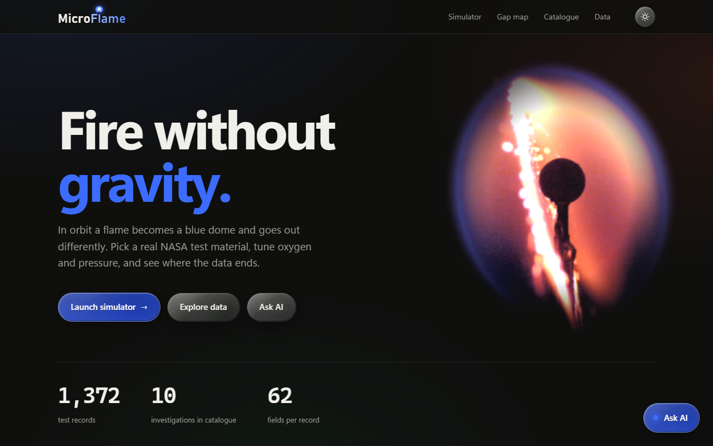
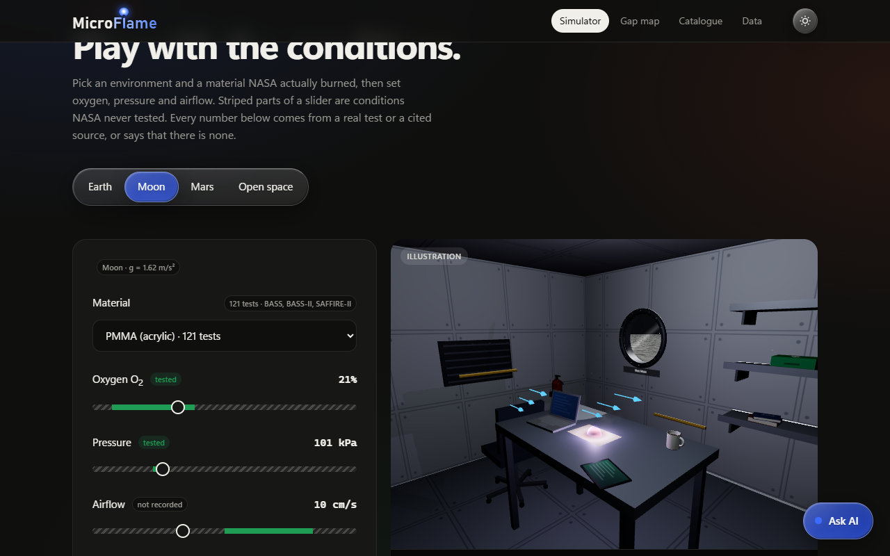
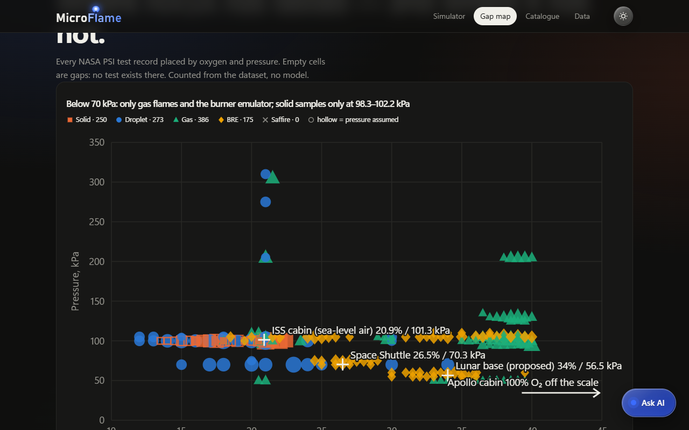

# MicroFlame

**What NASA knows about fire in microgravity, how well it applies to future spacecraft, and where there is no data.**

NASA Space Apps Challenge 2026 · "Flame in Freefall" · License: [TODO: choose license] · Live: [TODO: project link] · Video: [TODO: video link]




## What it does

MicroFlame is not a fire predictor. It places a chosen material, oxygen level and pressure against the NASA PSI test records and shows what was actually measured there, how close those tests are to the chosen conditions, and where no test exists. A gap map shows the whole dataset by O₂ × pressure, with empty cells marked "no tests". The catalogue and the record table expose all 1,372 records with their data-quality notes, and any selection can be downloaded as CSV or Excel. A 3D cabin illustrates how gravity changes the scene; it computes no spread rate, burn time or risk.

## Key findings

- 1,372 test records, 10 investigations in the catalogue, 62 fields per record. The records come from NASA PSI: Saffire I–III, BASS, BASS-II, FLEX, ACME BRE, CFI-G and Flame Design.
- Solid materials (BASS, BASS-II) were tested only around 1 atm and up to about 22.7 % O₂. The dataset maximum is 40 % O₂.
- Planned exploration atmosphere: 8.2 psia (56.5 kPa) and 34 % O₂. Shuttle staged atmosphere: 10.2 psia (70.3 kPa) and 26.5 % O₂. There are no solid-material tests in the 56.5 kPa / 34 % O₂ region.
- The PSI data used has no direct measurements at lunar or Martian gravity.
- NASA-STD-6001 (1998 edition) Test 1 is a ground test and never mentions gravity.



## How it works

| Part | What it does |
|---|---|
| Data pipeline | `firegap_dataset/scripts/psi_pipeline.py` has one adapter per investigation table (13). Missing values stay empty; every row carries a `data_quality_note`; raw and assumed values (`*_raw`, `pressure_kpa_assumed`) sit next to the normalized ones; skipped rows are listed with a reason in `skipped_rows.json`. |
| Simulator matching | `backend/app/simulator.py` groups materials into 14 families and shows the closest real test (investigation and test id) only if it is within ±1 pp O₂ and ±5 kPa; otherwise the panel says "Not in NASA data". It never extrapolates. |
| Assessment engine | `assistant/engine.js` in the dataset (served at `/engine/engine.js`, data at `/api/knowledge/engine-data`): "same conditions" = ±2 pp O₂ and ±10 % pressure, "nearby" = ±5 pp and ±25 %; levels `data` (≥3 tests) / `few` / `near` / `none`; verdict `solid` / `indirect` / `none`; templated text, no model. The current page does not display it. |
| 3D cabin | `frontend/js/cabin3d.js` (three.js + cannon-es). Gravity from NASA fact sheets via `backend/data/environments.json`: Moon 1.62 m/s², Mars 3.73 m/s², open space 0. Labeled ILLUSTRATION; the camera stays inside the room. |
| Fact base | `data/facts_all.csv`: 51 sourced facts — 20 from the NASA ISS Researcher's Guide (with page numbers), 31 from NASA-STD-6001 and the literature; each is labeled "full text read" (29) or "abstract only" (22). |
| Gap map | `scripts/build_analytics.py` derives `frontend/assets/analytics.json` from `tests.csv` with `backend/app/analytics.py`; the page draws it as SVG. The same derivation filters the CSV export, so both count the same rows. |

## Quick start (Windows PowerShell, Python 3.12)

```powershell
python -m venv .venv
.\.venv\Scripts\python.exe -m pip install -r backend\requirements.txt -r ai_assistant\requirements.txt
Copy-Item ai_assistant\.env.example ai_assistant\.env   # optional: put a GROQ_API_KEY in it for the chat
.\.venv\Scripts\python.exe -m uvicorn backend.app.main:app --port 8001
```

Open http://127.0.0.1:8001/. The site has no build step: the backend serves `frontend/` as is, and the browser loads nothing from the network. Without a Groq key everything works except the chat, which reports that AI is not configured. API docs: http://127.0.0.1:8001/docs.

Rebuild the gap-map data after changing `tests.csv`:

```powershell
.\.venv\Scripts\python.exe scripts\build_analytics.py
```

Tests (the browser tests use the installed Microsoft Edge):

```powershell
.\.venv\Scripts\python.exe -m unittest backend.tests.test_security backend.tests.test_offline backend.tests.test_csv_data backend.tests.test_simulator backend.tests.test_knowledge
.\.venv\Scripts\python.exe -m pip install playwright pillow
.\.venv\Scripts\python.exe -m unittest e2e.test_site e2e.test_room e2e.test_glass
```

## Reproduce the dataset

`firegap_dataset/scripts/rebuild_all.sh` runs `psi_pipeline.py` over the original PSI downloads: each investigation's ISA metadata (`i_Investigation.txt`) and its experimental tables (CSV or XLSX), plus the hand-built tables in `firegap_dataset/data/` (BRE from the dissertation, E-FIELD Table 1). Get the inputs from the NASA PSI repository: https://psi.nasa.gov/. The script still contains the absolute paths of the machine it was written on (`/mnt/user-data/uploads`, `psi_extract*/`); edit them to your download folder before running. [TODO: confirm the exact PSI download steps and file names]

## Repository structure

```
backend/app/        FastAPI app: data API, CSV/Excel export, simulator matching, chat endpoint, request guard
backend/data/       environments.json (gravity), facts_en.json, and the served FireGap dataset copy
backend/tests/      backend unit tests
ai_assistant/       chat: TF-IDF retrieval over the dataset + Groq-hosted model
firegap_dataset/    dataset as delivered: tests.csv, studies.json, scripts/, charts/
frontend/           the website: index.html, js/ (3D cabin, gap map), css/, vendor/ (three.js, cannon-es), assets/
frontend/src/       earlier React/Vite prototype (not used by the served site)
scripts/            build_analytics.py (gap-map data)
e2e/                Playwright browser tests and the ?perf=1 profiler
docs/               screenshots, performance profiles, Liquid Glass demo
```

## Data and sources

The served copy is `backend/data/firegap_dataset/firegap_dataset/`.

| File | Contents |
|---|---|
| `tests.csv` | 1,372 test records, 62 columns, incl. `data_quality_note`, raw/assumed fields and `gravity_regime` |
| `studies.json` | metadata of 13 PSI studies (platform, hardware, objectives, publications) |
| `skipped_rows.json` | every skipped source row with its experiment and reason |
| `data/facts_all.csv` | 51 sourced facts (G01–G20 ISS Researcher's Guide, X01–X31 NASA-STD-6001 and literature) |
| `data/external_sources.csv` | the non-PSI sources (NASA-STD-6001, partial-gravity literature) with a `verified` column |
| `data/iss_guide_facts.csv` | the 20 ISS Researcher's Guide facts with page numbers |

Source links are in [`data/external_sources.csv`](backend/data/firegap_dataset/firegap_dataset/data/external_sources.csv) and in the publications listed in `studies.json`.

> **Note:** the data are analyst-prepared from PSI and were not independently revalidated. Read `data_quality_note` and the raw/assumed fields before interpreting values.

## AI usage

Claude (Anthropic) was used as a coding and research assistant.

The in-product chat (`ai_assistant/main.py`) retrieves the 5 most similar excerpts from the dataset files (TF-IDF) and sends them to a Groq-hosted language model (default `openai/gpt-oss-20b`). The prompt tells it to prefer the dataset, name the experiment and test, never invent measurements, test ids or numbers, and say explicitly when an answer comes from general combustion knowledge. When no excerpt matches, the page labels the reply "General knowledge, not from the dataset". It replies in the language of the question.

## Limitations

- Not a predictor and not a safety certification; it does not replace NASA-STD-6001 testing.
- The 3D view is an illustration only; it computes no spread rate, burn time or risk.
- Facts marked "abstract only" were not read in full.
- There is no direct data for the Moon or Mars.
- The chat can answer from general knowledge when the dataset has nothing; such replies are labeled.

## Team

Team name: [TODO]

| Name | Role |
|---|---|
| Nurbolot Bekbolotov | TeamLead / Frontend |
| Aziret Arzymatov | Research assistant / Speaker |
| Zhumanazar Ashirbekov | Research assistant / Speaker |
| Aibek Kozhobekov | AI architect |
| Nurzhigit Arapbaev | Backend |
| Ulukbek Bolotbekov | Frontend |

## Acknowledgements and credits

- Test data: NASA Physical Sciences Informatics (PSI), https://psi.nasa.gov/.
- Gravity values: NASA NSSDCA Planetary Fact Sheets (see `backend/data/environments.json`).
- three.js r160 and cannon-es 0.20.0 (MIT), vendored in `frontend/vendor/` with their licence files.
- No external 3D models or textures: every cabin item and the porthole views are built procedurally in code by this project. Details: [CREDITS.md](CREDITS.md).
- Hero photo `frontend/assets/hero-flame.webp`: supplied by the team; [TODO: original source and licence].

This project is not affiliated with or endorsed by NASA.

## License

[TODO: choose license]. Check the NASA PSI data terms of use before choosing one for the data files.
